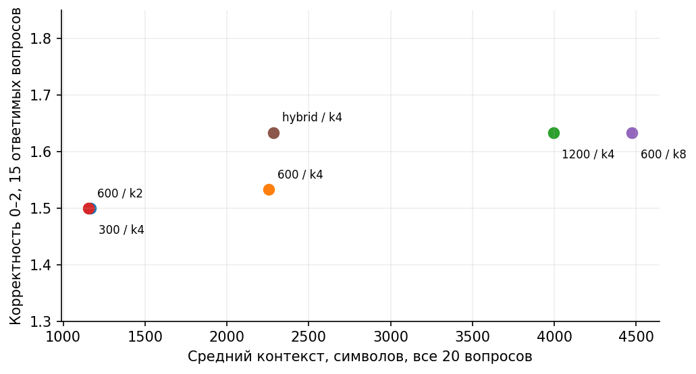

# ЛР9 Повышение качества RAG

Продолжение ЛР8: пять исходных документов с 40 неизменёнными абзацами объединены по исходным файлам; добавлен шестой учебный регламент SOC для следующих работ. Из 20 вопросов 15 ответимых, 5 без ответа в корпусе. Все 16 вопросов ЛР8 сохранены дословно. Эталонные doc_id, факты и цитаты записаны до генерации.

Гипотеза: гибрид dense + символьный TF-IDF улучшит поиск точных обозначений RPO/RTO/TLS/VPN. RRF использует c=60. Сравниваются размеры 300/600/1200 символов, overlap 0/100/200, k 2/4/8, лексический поиск, гибрид и второй этап по признакам. Переранжирование: одинаковые dense top-12, затем 0.65×cosine_dense + 0.35×cosine_TFIDF. Это фиксированный эвристический скорер, не обученный cross-encoder; вес не подбирался по результатам. Дополнительно сравнивается общий бюджет 2200 символов целых фрагментов.

Документные Hit/Recall/MRR рассчитываются после удаления повторных doc_id в выдаче; неответимые вопросы исключены. Дополнительно проверяется, попал ли конкретный факт в контекст: один правильный doc_id этого не гарантирует. ACL применяется до построения индекса. Роль эксперимента admins имеет доступ ко всем учебным документам; students не получает network и soc.

```powershell
python src/evaluate.py --search
python src/evaluate.py --generate
python -m unittest discover -s tests -v
```

Поиск: 13 конфигураций × 20 вопросов × 3 повтора = 780 записей. Генерация: 6 конфигураций × 20 вопросов × 2 seed = 240 запросов. Порядок чередуется по вопросу/seed. Отчёт отдельно выделяет базовую, лучшую по документному Recall и компромиссную конфигурации. Перекрытие измеряется в символах, начало корректируется до границы слова; реальные смещения сохранены. Лимит 2200 — эксперимент по символьному бюджету, не равенство токенов.

Файл generation.jsonl дописывается с пропуском уже записанных ключей; ошибочные попытки сохраняются. Для нового полного эксперимента архивируйте прежний файл и запустите повторно, не смешивая изменённые настройки. В таблицах длительность API включает передачу и генерацию, TTFT отдельно не измерен.

## Измеренный результат

| Конфигурация | Recall по doc_id | Средний балл ответа 0–2 | Контекст, символов |
| --- | ---: | ---: | ---: |
| 300 / 100 / k4 | 1.000 | 1.500 | 1166 |
| База 600 / 100 / k4 | 0.900 | 1.533 | 2256 |
| Hybrid 600 / 100 / k4 | 0.900 | 1.633 | 2285 |

Контекст усреднён по всем 20 вопросам, балл — по 15 ответимым; значения усреднены по двум seed. На пяти неответимых вопросах во всех шести конфигурациях получены отказы (60/60), но побочные утверждения могут быть ошибочными. Hybrid выбран как компромисс по этому контрольному набору, без отдельного тестового набора. Лучший документный Recall не гарантирует наличие конкретного факта внутри фрагмента.



**Вывод:** границы фрагментов и семантическая проверка ссылок важнее одного числа Recall. Следующее улучшение — разбиение по предложениям и независимые вопросы.

## Среда и воспроизводимость

Python 3.12.14, LM Studio, локальная модель `gemma-4-12b-coder-fable5-composer2.5-v1` (community, yuxinlu1, Q3_K_M). SHA256 GGUF и снимок API сохранены в `results/`. Контекст 8192, один параллельный запрос, GPU offload max, `reasoning_effort=none`, температура 0.2. Seeds 42/43. Seeds не гарантируют побитовую детерминированность сервера.

Для поиска используется локальная многоязычная MiniLM из ЛР7–8: `sentence-transformers/paraphrase-multilingual-MiniLM-L12-v2`, revision `e8f8c211226b894fcb81acc59f3b34ba3efd5f42`, 384 измерения, CPU, 4 потока, нормализация, max_seq_length 512. При превышении лимита скрипт завершится с ошибкой, а не обрежет текст молча.

Команды запускайте в терминале PyCharm из папки соответствующей работы. Требуется весь репозиторий: ЛР10 импортирует поиск и локальный HTTP-клиент из ЛР9, ЛР11 — также диспетчер из ЛР10. Это явная сквозная интеграция, а не отдельные копии инструментов.

```powershell
python -m venv .venv
.\.venv\Scripts\Activate.ps1
python -m pip install -r requirements.txt
$env:LLM_BASE_URL="http://127.0.0.1:1234/v1"
$env:LLM_MODEL="gemma-4-12b-coder-fable5-composer2.5-v1"
# Если модель эмбеддингов уже скачана, задайте путь:
# $env:EMBEDDING_MODEL_PATH="C:/models/minilm-multilingual"
```

Сервер генерации нужно предварительно запустить в LM Studio. Указанные в `configs/` модель и параметры определяют измеряемый эксперимент. API вызывается стандартной библиотекой `urllib` по протоколу Chat Completions, поэтому пакет openai не требуется. В `requirements-lock.txt` записан фактический состав среды. Первый запуск эмбеддингов без локального пути может скачать фиксированную ревизию; генерация и поиск выполняются локально.

Все документы, инциденты, оповещения и оценки IP учебные. Адреса IP из документационных диапазонов не сканируются и не проверяются через интернет. Ключей в журнале нет; `.env` игнорируется Git, пример содержит только имена настроек. Контекст передаётся только loopback-серверу, прокси и редиректы отключены. Полные журналы допустимы здесь только потому, что содержат синтетические данные.

## Материалы

`configs/` — план и неизменные настройки; `data/` — входные данные; `src/` — программа; `tests/` — проверки; `results/` — сырые ответы, трассы, метрики и оценка; `figures/` — графики; `report/report.md` — публичный отчёт. Word-копия для преподавателя с личным титульным листом хранится отдельно и не публикуется.

Содержание ответов оценивается по исходным данным, сохранённым ответам и указанным критериям. Имитатор и проверки управляющей программы не включаются в метрики качества реальной модели. Малый набор, два/три повтора и одна машина не позволяют обещать такие же результаты в промышленной системе.

## Пересчёт сохранённых результатов

`python src/summarize.py` проверяет контрольные суммы ответов и пересчитывает сводку по сохранённой отдельной оценке. Для новых ответов сначала нужна новая содержательная разметка: скрипт не присваивает оценки автоматически. Графики всех трёх работ строятся командой `python src/build_figures.py` из папки ЛР9 после установки её `requirements-figures.txt`.

Полный [отчёт](report/report.md), [архитектура](figures/architecture.png) и [результаты](results/) доступны без запуска программы.
