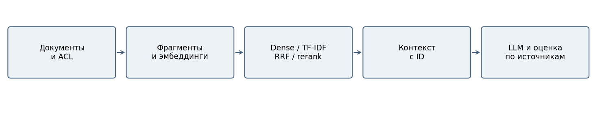
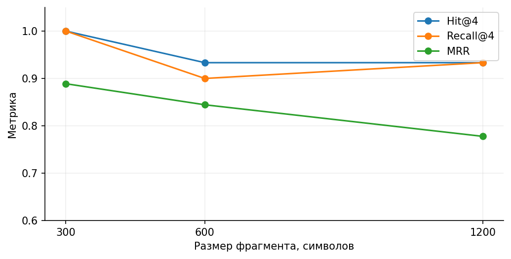
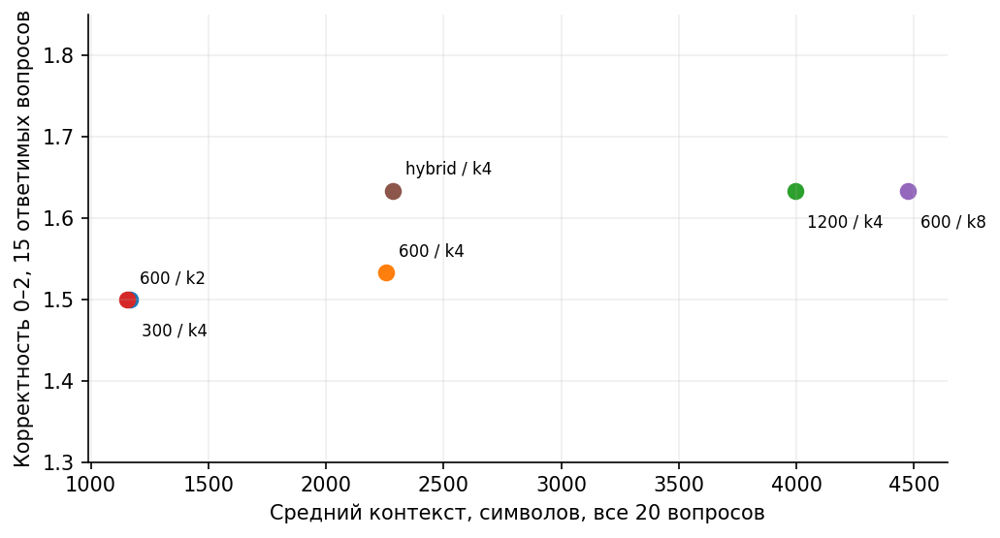

# Лабораторная работа 9

ПОВЫШЕНИЕ КАЧЕСТВА RAG-СИСТЕМЫ

## Цель и гипотеза

Исследовать, как разбиение документов, количество фрагментов и способ поиска влияют на RAG. Бизнес-кейс — помощник службы ИБ по учебным регламентам. Гипотеза: добавление лексического поиска улучшит ответы на вопросы с точными обозначениями RPO, RTO, TLS и VPN. Нужен ответ с проверяемым источником и честный отказ, когда конкретных данных нет.

## Исходные данные и архитектура

ЛР8 воспроизведена на исходной Gemma 3n: вопрос q01 о восстановлении получил ответ, q13 о телефоне — отказ. В новой серии генератор заменён на Gemma 4; поэтому показатели новой серии нельзя считать чистым улучшением относительно прежних 48 ответов ЛР8. Внутри ЛР9 модель и системный промпт неизменны.

Пять исходных документов содержат 40 неизменённых абзацев из ЛР7–8. Добавлен шестой синтетический регламент SOC KB-01–KB-03 для интеграции ЛР10–11. Все 16 вопросов ЛР8 сохранены дословно; добавлены три ответимых вопроса и один неответимый. Итого 20 вопросов: 15 ответимых, 5 неответимых. Эталоны doc_id и проверяемые факты записаны до генерации.

Использована локальная Gemma 4 12B community yuxinlu1, Q3_K_M в LM Studio: контекст 8192 токена, один параллельный запрос, GPU offload max, температура 0,2, reasoning_effort=none. Сервер доступен через loopback. Эмбеддинги — многоязычная MiniLM, 384 измерения, нормализованные векторы, CPU и 4 потока. Ревизия эмбеддингов e8f8c211226b894fcb81acc59f3b34ba3efd5f42; лимит 512 токенов проверяется до кодирования.

Лимит ответа: 650 токенов. Повторы: seeds 42/43 в ЛР9 и 42/43/44 в ЛР10–11. Все исходные запросы сохранены.

Стенд: Windows 11, Ryzen 7 7800X3D, RTX 5060 Ti с 8151 МиБ видеопамяти. Python 3.12.14, sentence-transformers 6.2.0, NumPy 2.5.4, scikit-learn 1.9.1, torch 2.14.1+cpu. Это один локальный стенд, фоновые процессы не изолированы. Измеренная задержка включает HTTP-обмен и обработку; TTFT и чистая скорость декодирования отдельно не измеряются.

## План и правила оценки

Базовая конфигурация: 600 символов, overlap 100, dense, k=4. Меняется один фактор: размер 300/600/1200, overlap 0/100/200, k=2/4/8. Также сравниваются символьный TF-IDF (3–5-граммы), RRF dense+TF-IDF с c=60 и второй этап по фиксированным признакам. Поиск повторён трижды: 13 конфигураций × 20 вопросов × 3 = 780 записей. Поисковые результаты детерминированы; повторы нужны главным образом для наблюдения времени.

Переранжирование получает те же dense top-12 кандидатов и сортирует по 0,65×dense cosine + 0,35×TF-IDF cosine. Это эвристический скорер, не нейронный cross-encoder; качество обученного reranker здесь не измерялось. Дополнительный эксперимент ограничивает контекст 2200 символами целых фрагментов; одинаковое число символов не означает одинаковое число токенов.

Hit@k показывает наличие хотя бы одного эталонного doc_id, Recall@k — долю эталонных документов, MRR — обратный ранг первого релевантного документа. Повторные doc_id удаляются с сохранением первого появления. Вопросы без ответа исключены из этих метрик. Doc_id не доказывает наличие нужного предложения внутри извлечённого фрагмента.

| Код | Размер | Overlap | k | Метод |
| --- | --- | --- | --- | --- |
| C1 | 300 | 100 | 4 | dense |
| C2 | 600 | 100 | 4 | dense |
| C3 | 1200 | 100 | 4 | dense |
| C4 | 600 | 0 | 4 | dense |
| C5 | 600 | 200 | 4 | dense |
| C6 | 600 | 100 | 2 | dense |
| C7 | 600 | 100 | 8 | dense |
| C8 | 600 | 100 | 4 | hybrid |
| C9 | 600 | 100 | 4 | lexical |
| C10 | 600 | 100 | 4 | rerank |
| C11 | 300 | 100 | 12 | dense бюджет 2200 |
| C12 | 600 | 100 | 12 | dense бюджет 2200 |
| C13 | 1200 | 100 | 12 | dense бюджет 2200 |

## Качество поиска

| Код | Фрагм. | Hit | Recall | MRR | Контекст | Поиск мс |
| --- | --- | --- | --- | --- | --- | --- |
| C1 | 54 | 1.000 | 1.000 | 0.889 | 1161 | 22.340 |
| C2 | 22 | 0.933 | 0.900 | 0.844 | 2253 | 23.570 |
| C3 | 11 | 0.933 | 0.933 | 0.778 | 3966 | 25.440 |
| C4 | 22 | 0.933 | 0.900 | 0.839 | 2159 | 20.340 |
| C5 | 27 | 0.933 | 0.900 | 0.856 | 2189 | 34.810 |
| C6 | 22 | 0.800 | 0.767 | 0.800 | 1152 | 27.280 |
| C7 | 22 | 1.000 | 0.967 | 0.867 | 4484 | 27.540 |
| C8 | 22 | 0.933 | 0.900 | 0.900 | 2274 | 33.220 |
| C9 | 22 | 0.933 | 0.900 | 0.889 | 2242 | 23.430 |
| C10 | 22 | 1.000 | 0.967 | 0.911 | 2262 | 26.410 |
| C11 | 54 | 1.000 | 1.000 | 0.889 | 2077 | 81.760 |
| C12 | 22 | 0.867 | 0.833 | 0.822 | 2102 | 65.280 |
| C13 | 11 | 0.800 | 0.767 | 0.733 | 2019 | 22.530 |

Размер 300 даёт Recall=1,000 против 0,900 у базы, но сам по себе не гарантирует наличие факта. При overlap 200 индекс растёт с 22 до 27 фрагментов, Recall остаётся 0,900. Увеличение k с 4 до 8 поднимает Recall до 0,967 и примерно удваивает контекст. Hybrid сохраняет Recall базы, но повышает MRR с 0,844 до 0,900. Второй этап по признакам повышает Recall до 0,967 и MRR до 0,911 при том же candidate_N; Hit@12 равен 1,000. Это результат данного малого набора, а не гарантия для другого корпуса.

## Качество ответов

Для шести конфигураций получено 240 реальных ответов: 20 вопросов × два seed 42/43. Порядок конфигураций чередовался для каждого вопроса. Корректность: 0 — нет нужного ответа/ошибка, 1 — частичный ответ, 2 — существенные запрошенные факты верны. Обоснованность и ссылки проверялись отдельно по конкретному контексту. Для объединённой ссылки [S1, S2] подтверждение оценивается по объединению указанных фрагментов; одних существующих меток недостаточно. Отказ на ответимый вопрос даёт 0 по корректности; доля отказов считается только по пяти неответимым вопросам.

| Режим | Балл 0–2 | Полных | Обосн. | Ссылки | Отказ | Время с |
| --- | --- | --- | --- | --- | --- | --- |
| 300/k4 | 1.500 | 73.3% | 73.3% | 73.3% | 100.0% | 1.502 |
| База 600/k4 | 1.533 | 66.7% | 80.0% | 80.0% | 100.0% | 1.691 |
| 1200/k4 | 1.633 | 70.0% | 86.7% | 86.7% | 100.0% | 1.948 |
| 600/k2 | 1.500 | 70.0% | 66.7% | 66.7% | 100.0% | 1.486 |
| 600/k8 | 1.633 | 70.0% | 83.3% | 76.7% | 100.0% | 1.793 |
| Hybrid/k4 | 1.633 | 70.0% | 83.3% | 83.3% | 100.0% | 1.555 |

| Режим | Контекст симв. | Промпт симв. | Промпт ток. | SD времени |
| --- | --- | --- | --- | --- |
| 300/k4 | 1166 | 2129 | 574 | 0.589 |
| База 600/k4 | 2256 | 3221 | 822 | 0.785 |
| 1200/k4 | 3994 | 4962 | 1220 | 0.632 |
| 600/k2 | 1156 | 2022 | 521 | 0.469 |
| 600/k8 | 4475 | 5633 | 1440 | 0.531 |
| Hybrid/k4 | 2285 | 3252 | 829 | 0.533 |

Три основные точки: базовая 600/k4, лучшая по документному Recall 300/k4 и компромиссная Hybrid/k4. Hybrid достигает среднего 1,633/2 при среднем контексте 2285 символов; варианты 1200/k4 и 600/k8 получают тот же балл при 3994 и 4475 символах. 300/k4 экономнее и имеет больше полностью верных ответов, но чаще полностью пропускает нужный факт. Для учебного помощника выбирается Hybrid/k4 как компромисс средней полноты и длины. Выбор сделан по этому же контрольному набору, поэтому перед внедрением нужен независимый тест.

Во всех 60 проверках неответимых вопросов модель явно сообщила о недостатке сведений. Это не означает отсутствия ошибок во всём тексте: например, q16 в базовой конфигурации при seed=42 ошибочно называет условный пример RPO=4 часа определённым значением. Запрашиваемое RTO бухгалтерии при этом не выдумано. Небольшие орфографические дефекты сохранены в исходных ответах.

## Разбор ошибок и демонстрация

q03: Как часто владельцы систем пересматривают роли сотрудников?

Ответ модели: В предоставленных источниках недостаточно информации. В текстах не указана периодичность проверки ролей сотрудниками со стороны владельцев систем.

Найдены: access:300:100:4, access:300:100:2, incident:300:100:8, access:300:100:3. Эталон access_07: «Раз в квартал владельцы систем проверяют назначенные роли сотрудников». Документ access найден, но нужный абзац не попал в малые top-4. База 600/k4 содержит периодичность и отвечает верно: это ошибка отбора фрагментов, скрытая документным Hit.

q05: Какие сведения нельзя записывать в журналы приложения и чем их заменяют для диагностики?

Ответ модели: В журналах нельзя записывать персональные данные [S1]. Для диагностики вместо них используются сочетание безопасных кодов ошибок и идентификатора запроса [S1].

Найдены: development:600:100:2, incident:600:100:1, incident:600:100:3, backup:600:100:3. Эталон development_05 запрещает токены, пароли и полные персональные данные. Найденный фрагмент начинается словами «персональные данные» — начало предложения с запретом потеряно. Модель отвечает только про персональные данные. Нужны границы предложений/расширение соседнего фрагмента; увеличение k до 8 в этой серии не исправило потерю.

q08: В git попал секрет для обращения к сервису. Достаточно ли стереть строку?

Ответ модели: Нет, недостаточно просто стереть строку из исходного кода. Согласно правилам безопасности, секреты должны храниться в специальном хранилище, а не в исходном коде или общей таблице [S2]. Удаление строки из репозитория не аннулирует факт утечки секрета в истории изменений; для восстановления безопасности требуется процедура отзыва и регистрации нового секрета [S2].

Найдены: network:600:100:1, access:600:100:2. Модель при seed=43 правильно советует отзыв секрета, но ссылается на access о сервисных учётных записях, где нет конкретного утверждения об истории Git. Фактическая правильность ответа не равна подтверждённости ссылки.

Демонстрация ответа: Какие сведения фиксируют для нового разрешающего правила межсетевого экрана? → Для нового разрешающего правила фиксируются источник, назначение, порт, владелец и срок [S1].

Демонстрация отказа: Какой номер телефона у дежурного специалиста нашей службы безопасности? → В предоставленных источниках недостаточно информации.

## Информационная безопасность

| Угроза | Реализованная мера | Оставшееся ограничение |
| --- | --- | --- |
| Чужие документы | ACL до индекса/выдачи контекста; серверная роль | Учебные роли, без промышленной аутентификации |
| Команды внутри источника | Данные отделены от system; только фиксированные функции чтения | Текст может исказить рекомендацию модели |
| Неверные вызовы | Allowlist, точные поля, типы, длины, ID/IP, лимиты | JSON Schema сама не является политикой доступа |
| Утечки через журнал | Синтетические данные, без ключей; .env игнорируется | На реальных данных нужна минимизация и редактирование логов |
| Ошибочные утверждения | Проверка по возвращённым источникам и трассам | Модель и экспертная оценка могут ошибаться |

Оценки ответов приведены отдельно от результатов автоматических тестов. Исходные модельные ответы, включая ошибки, сохранены. Испытания с внедрённой командой доказывают блокировку опасной операции политикой приложения; они не доказывают универсальную устойчивость LLM к инъекциям.

## Вывод

Гипотеза подтверждена частично: Hybrid улучшил ранги и отдельные ответы (например, правило межсетевого экрана и проверку прав на объект), но общий Recall не вырос. Увеличение контекста не является универсальным решением. Для дальнейшей работы нужны разбиение по предложениям, проверка точных фактов и независимый набор вопросов. Нейронное переранжирование оставлено расширением; вместо него измерен честно обозначенный фиксированный второй этап.

## Ответы на контрольные вопросы

Почему малые фрагменты не всегда лучше? Они точнее локализуют тему, но могут отрезать условие или нужное предложение.

Что меняет overlap? Уменьшает потери на границах ценой размера индекса и дублирования выдачи.

Почему фиксированного k недостаточно? Четыре фрагмента по 300 и по 1200 символов дают разный бюджет контекста.

Dense и лексический поиск Dense сопоставляет смысл, TF-IDF — форму терминов; гибрид объединяет ранги.

Что такое RRF? Сумма 1/(c+rank) по спискам; это не вероятность правильного ответа.

Ограничение reranker Он выбирает из кандидатов и не возвращает документ, которого там нет.

Hit, Recall и MRR Наличие хотя бы одного документа, полнота множества документов и ранг первого релевантного.

Зачем doc_id? Он устойчив при изменении chunk size, в отличие от chunk_id.

Может ли Recall вырасти при худшем ответе? Да: отвлекающий контекст, неполный факт или ошибка генерации могут ухудшить ответ.

Как проверить ссылку? Сопоставить конкретное утверждение с текстом указанного фрагмента, а не только проверить ID.

Что делать с prompt injection? Считать источник данными, ограничить действия программно, проверять результат.

Что нужно для воспроизведения? Корпус, эталоны, хеши моделей, конфигурации, версии, код, сырые ответы и правила оценки.

## Воспроизведение и источники

Репозиторий: https://github.com/everythingisavailable/student-labs/tree/main/lab09-rag-optimization. Команды запуска, зависимости и форматы данных приведены в README этой работы. Сырые ответы не исправлялись; оценка содержания хранится отдельно с контрольными суммами ответов. Дата эксперимента: 1 ноября 2026 года.

Методические указания СибАДИ к соответствующей лабораторной работе, предоставленные для выполнения задания. Документация LM Studio по tool calling: https://lmstudio.ai/docs/developer/openai-compat/tools. Модель эмбеддингов: https://huggingface.co/sentence-transformers/paraphrase-multilingual-MiniLM-L12-v2. Документация поиска: https://www.sbert.net/examples/sentence_transformer/applications/semantic-search/README.html.
