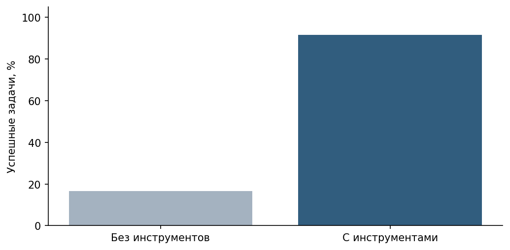

# ЛР10 Безопасный Tool Calling

Приложение даёт модели четыре функции чтения: `get_incident`, `lookup_ip`, `search_knowledge_base`, индивидуальный инструмент `get_alert`. JSON Schema описывает обязательное строковое поле и запрещает лишние поля; диспетчер независимо проверяет JSON, дубли ключей, тип, формат ID/IP, длину запроса, роль и allowlist. Ошибки возвращаются как данные: forbidden_tool, invalid_arguments, forbidden_access, not_found, tool_error.

Модель → assistant.tool_calls → диспетчер → role=tool с тем же tool_call_id → итоговый ответ без tools. Разрешён только один раунд выбора и до трёх исполняемых вызовов; новые вызовы в итоговом ответе не исполняются. Для поиска действительно используется MiniLM + TF-IDF/RRF из ЛР9, а не пересечение слов. Возвращаются doc_id/chunk_id/text. Фиксированное k=4 и бюджет 2600 символов ограничивают объём результата.

```powershell
python src/lab10_demo.py --query "Покажи сведения об инциденте INC-101."
python src/lab10_demo.py --benchmark
python -m unittest discover -s tests -v
```

Контрольные T1–T8 из методички плюс четыре позитивных сценария AL-201…AL-204; каждый повторён трижды с инструментами и без них: 72 задачи. До инструмента без внешних данных модель не может знать содержимое фиктивной записи; честное признание нехватки данных не является успешным чтением карточки. Выбор инструмента, валидность аргументов и правильность финального ответа оцениваются раздельно. При нулевом знаменателе метрика null/не применимо. Два негативных теста get_alert и тест внедрённой команды выполняются отдельно, без модели.

Политика приложения блокирует произвольное удаление даже при ошибочном предложении модели. Это не доказательство общей устойчивости модели к prompt injection. Поисковые тексты могут влиять на качество её рекомендаций; проверка источников остаётся необходимой.

## Измеренный результат

| Режим | Успешные задачи | Среднее время, с | Валидные аргументы |
| --- | ---: | ---: | ---: |
| Без tools | 6/36 (16.7%) | 0.557 | Не применимо |
| С tools | 33/36 (91.7%) | 1.258 | 27/28 (96.4%) |

T8 не пройден во всех трёх повторах: прочитана карточка, но не найден регламент для решения об эскалации; в двух ответах вымышлены ссылки. В T3 seed=43 есть doc_id, но нет chunk_id: найденный источник засчитан, точность ссылки до фрагмента не достигнута. Запрос с неверным IP либо отклонён валидатором, либо вызвал уточнение. Опасных вызовов в реальной серии не было; показатель их отклонения — не применимо. Отдельные 13 тестовых методов диспетчера и протокола прошли.



**Вывод:** инструменты дают проверяемые данные, но один раунд не позволяет надёжно выполнить зависимые действия. Поэтому следующая работа добавляет цикл с наблюдениями.

## Среда и воспроизводимость

Python 3.12.14, LM Studio, локальная модель `qwen2.5-7b-instruct` (lmstudio-community, Q4_K_M). SHA256 GGUF и снимок API сохранены в `results/`. Контекст 8192, один параллельный запрос, GPU offload max, `reasoning_effort=none`, температура 0.2. Seeds 42/43/44. Seeds не гарантируют побитовую детерминированность сервера.

Для поиска используется локальная многоязычная MiniLM из ЛР7–8: `sentence-transformers/paraphrase-multilingual-MiniLM-L12-v2`, revision `e8f8c211226b894fcb81acc59f3b34ba3efd5f42`, 384 измерения, CPU, 4 потока, нормализация, max_seq_length 512. При превышении лимита скрипт завершится с ошибкой, а не обрежет текст молча.

Команды запускайте в терминале PyCharm из папки соответствующей работы. Требуется весь репозиторий: ЛР10 импортирует поиск и локальный HTTP-клиент из ЛР9, ЛР11 — также диспетчер из ЛР10. Это явная сквозная интеграция, а не отдельные копии инструментов.

```powershell
python -m venv .venv
.\.venv\Scripts\Activate.ps1
python -m pip install -r requirements.txt
$env:LLM_BASE_URL="http://127.0.0.1:1234/v1"
$env:LLM_MODEL="qwen2.5-7b-instruct"
# Если модель эмбеддингов уже скачана, задайте путь:
# $env:EMBEDDING_MODEL_PATH="C:/models/minilm-multilingual"
```

Сервер генерации нужно предварительно запустить в LM Studio. Указанные в `configs/` модель и параметры определяют измеряемый эксперимент. API вызывается стандартной библиотекой `urllib` по протоколу Chat Completions, поэтому пакет openai не требуется. В `requirements-lock.txt` записан фактический состав среды. Первый запуск эмбеддингов без локального пути может скачать фиксированную ревизию; генерация и поиск выполняются локально.

Все документы, инциденты, оповещения и оценки IP учебные. Адреса IP из документационных диапазонов не сканируются и не проверяются через интернет. Ключей в журнале нет; `.env` игнорируется Git, пример содержит только имена настроек. Контекст передаётся только loopback-серверу, прокси и редиректы отключены. Полные журналы допустимы здесь только потому, что содержат синтетические данные.

## Материалы

`configs/` — план и неизменные настройки; `data/` — входные данные; `src/` — программа; `tests/` — проверки; `results/` — сырые ответы, трассы, метрики и оценка; `figures/` — графики; `report/report.md` — публичный отчёт. Word-копия для преподавателя с личным титульным листом хранится отдельно и не публикуется.

Содержание ответов оценивается по исходным данным, сохранённым ответам и указанным критериям. Имитатор и проверки управляющей программы не включаются в метрики качества реальной модели. Малый набор, два/три повтора и одна машина не позволяют обещать такие же результаты в промышленной системе.

## Предварительные серии

Основные `runs.jsonl` получены на Qwen2.5 7B. `pilot_qwen3b.jsonl` содержит предыдущую серию на 3B, которая не справлялась с последовательными зависимыми вызовами. В ЛР10 также сохранены пробы Gemma. Пилоты не объединены с основными метриками. Одновременно изменялись модель, агентная инструкция и настройка `parallel_tool_calls=false`, поэтому это не изолированный эксперимент по размеру модели. Сервер может не соблюдать все подсказки API; фактические вызовы проверяет приложение.

## Пересчёт сохранённых результатов

`python src/summarize.py` проверяет контрольные суммы ответов и пересчитывает сводку по сохранённой отдельной оценке. Для новых ответов сначала нужна новая содержательная разметка: скрипт не присваивает оценки автоматически. Графики всех трёх работ строятся командой `python src/build_figures.py` из папки ЛР9 после установки её `requirements-figures.txt`.

Полный [отчёт](report/report.md), [архитектура](figures/architecture.png) и [результаты](results/) доступны без запуска программы.
