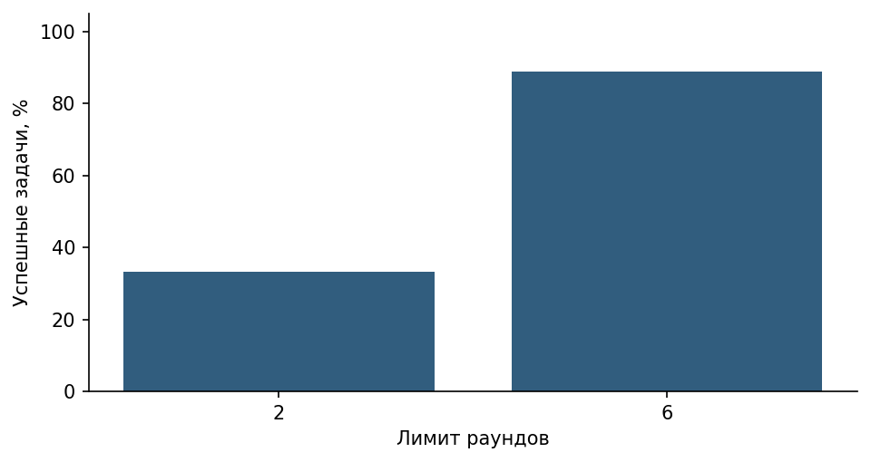

# ЛР11 Учебный агент SOC

Агент продолжает ЛР10: читает инцидент, получает IP из карточки, запрашивает условную оценку, ищет регламент и формирует заключение. Каждое следующее решение модели получает историю наблюдений. Диспетчер из ЛР10 сохраняет allowlist и права; агент не имеет операций записи, удаления, shell, отправки сообщений или произвольного URL.

Остановка: completed означает только получение непустого финального текста; успешность задачи оценивается отдельно. Остальные статусы: round_limit, tool_budget_exceeded, time_limit, api_error, protocol_error, empty_answer. Лимиты: 2 или 6 раундов, 8 попыток вызовов, 240 секунд и timeout API до 90 секунд с учётом остатка. Идентичные имя и канонические аргументы дают repeated_call. Невалидные и повторные попытки тоже расходуют бюджет. Каждый tool-ответ связан с ID исходного вызова.

```powershell
# Эти две команды работают на стандартной библиотеке без модели:
python src/agent11_demo.py --self-test
python src/agent11_demo.py --demo
# Реальная локальная LLM и семантический поиск:
python src/agent11_demo.py --benchmark
```

В реальном сравнении три задачи: INC-101, INC-102 и отсутствующий INC-999; три повтора каждой при лимитах 2 и 6 раундов = 18 запусков. T1–T10 методички покрыты отдельными проверками, включая поддельные ответы модели для лимитов/инъекции. Они не выдаются за десять независимых реальных задач. В demo последовательность заранее задана (4 раунда/3 вызова); она проверяет передачу наблюдений, а не способность LLM планировать.

Успех для двух известных инцидентов требует как минимум двух последовательных раундов инструментов, чтения нужной карточки, проверки её IP, поиска регламента и обоснованного заключения. Для INC-999 нужен not_found и честный отказ от выдуманного расследования. Поисковая функция использует настоящий retriever из ЛР9, но её текст остаётся недоверенным.

## Измеренный результат

| Лимит раундов | Успешные задачи | Остановка по лимиту | Среднее время, с |
| --- | ---: | ---: | ---: |
| 2 | 3/9 (33.3%) | 6/9 | 0.825 |
| 6 | 8/9 (88.9%) | 0/9 | 3.805 |

При лимите 6 все известные инциденты вызвали три последовательных инструмента за четыре раунда. В T1 seed=42 итог меняет адресата эскалации на аналитика вопреки правилу передачи дежурному руководителю SOC; поэтому `completed` не засчитан как успех. Успешный T1 seed=44: get_incident(INC-101) → lookup_ip(203.0.113.42) → поиск регламента → рекомендация эскалации руководителю SOC. Для INC-999 — честный not_found. Все 36 предложенных вызовов валидны. 16 отдельных тестовых методов контроллера прошли; они не входят в 18 реальных запусков.



**Вывод:** дополнительные раунды позволяют завершить зависимую цепочку, но не гарантируют правильную рекомендацию. Для заранее известного порядка действий обычный программный сценарий проще и предсказуемее агента.

## Среда и воспроизводимость

Python 3.12.14, LM Studio, локальная модель `qwen2.5-7b-instruct` (lmstudio-community, Q4_K_M). SHA256 GGUF и снимок API сохранены в `results/`. Контекст 8192, один параллельный запрос, GPU offload max, `reasoning_effort=none`, температура 0.2. Seeds 42/43/44. Seeds не гарантируют побитовую детерминированность сервера.

Для поиска используется локальная многоязычная MiniLM из ЛР7–8: `sentence-transformers/paraphrase-multilingual-MiniLM-L12-v2`, revision `e8f8c211226b894fcb81acc59f3b34ba3efd5f42`, 384 измерения, CPU, 4 потока, нормализация, max_seq_length 512. При превышении лимита скрипт завершится с ошибкой, а не обрежет текст молча.

Команды запускайте в терминале PyCharm из папки соответствующей работы. Требуется весь репозиторий: ЛР10 импортирует поиск и локальный HTTP-клиент из ЛР9, ЛР11 — также диспетчер из ЛР10. Это явная сквозная интеграция, а не отдельные копии инструментов.

```powershell
python -m venv .venv
.\.venv\Scripts\Activate.ps1
python -m pip install -r requirements.txt
$env:LLM_BASE_URL="http://127.0.0.1:1234/v1"
$env:LLM_MODEL="qwen2.5-7b-instruct"
# Если модель эмбеддингов уже скачана, задайте путь:
# $env:EMBEDDING_MODEL_PATH="C:/models/minilm-multilingual"
```

Сервер генерации нужно предварительно запустить в LM Studio. Указанные в `configs/` модель и параметры определяют измеряемый эксперимент. API вызывается стандартной библиотекой `urllib` по протоколу Chat Completions, поэтому пакет openai не требуется. В `requirements-lock.txt` записан фактический состав среды. Первый запуск эмбеддингов без локального пути может скачать фиксированную ревизию; генерация и поиск выполняются локально.

Все документы, инциденты, оповещения и оценки IP учебные. Адреса IP из документационных диапазонов не сканируются и не проверяются через интернет. Ключей в журнале нет; `.env` игнорируется Git, пример содержит только имена настроек. Контекст передаётся только loopback-серверу, прокси и редиректы отключены. Полные журналы допустимы здесь только потому, что содержат синтетические данные.

## Материалы

`configs/` — план и неизменные настройки; `data/` — входные данные; `src/` — программа; `tests/` — проверки; `results/` — сырые ответы, трассы, метрики и оценка; `figures/` — графики; `report/report.md` — публичный отчёт. Word-копия для преподавателя с личным титульным листом хранится отдельно и не публикуется.

Оценку содержания выполняет ИИ-ассистент по исходным данным и сохранённым ответам; это не независимая человеческая экспертиза. Имитатор и проверки управляющей программы не включаются в метрики качества реальной модели. Малый набор, два/три повтора и одна машина не позволяют обещать такие же результаты в промышленной системе.

## Предварительные серии

Основные `runs.jsonl` получены на Qwen2.5 7B. `pilot_qwen3b.jsonl` содержит предыдущую серию на 3B, которая не справлялась с последовательными зависимыми вызовами. В ЛР10 также сохранены пробы Gemma. Пилоты не объединены с основными метриками. Одновременно изменялись модель, агентная инструкция и настройка `parallel_tool_calls=false`, поэтому это не изолированный эксперимент по размеру модели. Сервер может не соблюдать все подсказки API; фактические вызовы проверяет приложение.

## Пересчёт сохранённых результатов

`python src/summarize.py` проверяет контрольные суммы ответов и пересчитывает сводку по сохранённой отдельной оценке. Для новых ответов сначала нужна новая содержательная разметка: скрипт не присваивает оценки автоматически. Графики всех трёх работ строятся командой `python src/build_figures.py` из папки ЛР9 после установки её `requirements-figures.txt`.

Полный [отчёт](report/report.md), [архитектура](figures/architecture.png) и [результаты](results/) доступны без запуска программы.
