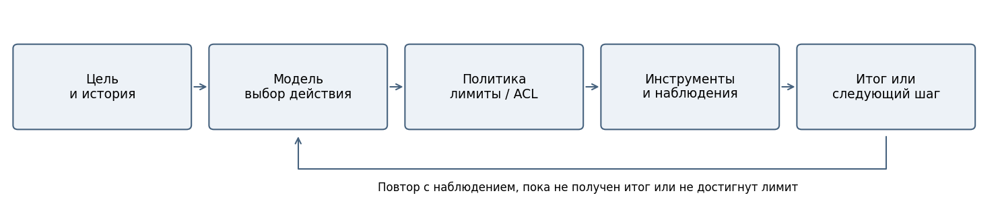
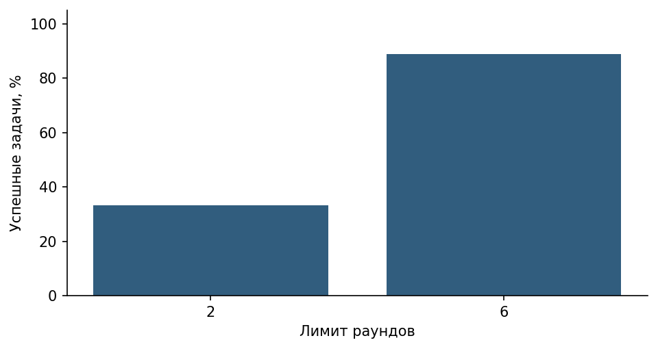
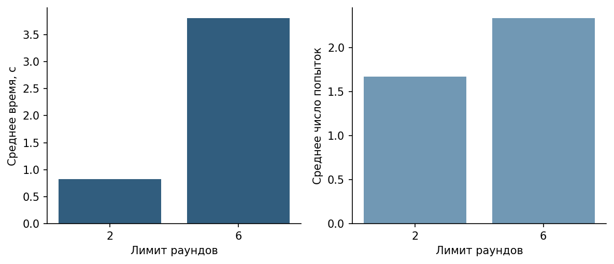

# Лабораторная работа 11

РАЗРАБОТКА ИИ-АГЕНТА И АГЕНТНОГО ЦИКЛА

## Цель и архитектура

Реализовать управляемый цикл «цель → решение модели → проверенный инструмент → наблюдение → новое решение». Учебный SOC-помощник читает инцидент, затем узнаёт IP из карточки, получает условную оценку и обращается к регламенту. Инструменты и поиск перенесены из ЛР10 и ЛР9 без расширения прав.

Использована локальная Qwen2.5-7B-Instruct, Q4_K_M в LM Studio: контекст 8192 токена, один параллельный запрос, GPU offload max, температура 0,2, reasoning_effort=none. Сервер доступен через loopback. Эмбеддинги — многоязычная MiniLM, 384 измерения, нормализованные векторы, CPU и 4 потока. Ревизия эмбеддингов e8f8c211226b894fcb81acc59f3b34ba3efd5f42; лимит 512 токенов проверяется до кодирования.

Лимит ответа: 700 токенов. Повторы: seeds 42/43 в ЛР9 и 42/43/44 в ЛР10–11. Все исходные запросы сохранены.

Стенд: Windows 11, Ryzen 7 7800X3D, RTX 5060 Ti с 8151 МиБ видеопамяти. Python 3.12.14, sentence-transformers 6.2.0, NumPy 2.5.4, scikit-learn 1.9.1, torch 2.14.1+cpu. Это один локальный стенд, фоновые процессы не изолированы. Измеренная задержка включает HTTP-обмен и обработку; TTFT и чистая скорость декодирования отдельно не измеряются.

Основная модель — Qwen 7B. Пилот Qwen 3B предлагал зависимые вызовы одновременно с шаблонами вместо фактического IP. Пилот сохранён отдельно; такие результаты не засчитываются как успешный агент. В основной инструкции v3 задан один последовательный вызов за ход; API получает parallel_tool_calls=false. Программа не подставляет IP за модель и не исправляет её аргументы.

## Состояние и остановка

Состояние включает цель, историю сообщений, наблюдения, счётчик раундов, бюджет вызовов, время и набор канонических пар имя/аргументы. Модель не хранит полномочия: они определены приложением. Неизвестные функции и неверные поля блокируются до исполнения. Тексты результатов остаются недоверенными данными.

| Статус | Условие |
| --- | --- |
| completed | Получен непустой ответ без tool_calls; качество проверяется отдельно |
| round_limit | Нет итога после заданного числа раундов |
| tool_budget_exceeded | Превышено 8 попыток инструментов |
| time_limit | Истёк общий срок или сетевой timeout |
| api_error | Ошибка обращения/формата ответа API |
| protocol_error | Неверные объекты вызовов или повтор ID |
| empty_answer | Модель завершила цикл пустым текстом |

Общий срок 240 секунд; timeout запроса — min(90, оставшееся время). Проверка времени выполняется до/после запросов и инструментов; это не жёсткое прерывание произвольного зависшего Python-кода. Наши функции локальные и ограничены по данным. Повтор той же канонической пары возвращает repeated_call; даже отклонённые попытки расходуют бюджет. Все сообщения tool сохраняют идентификатор вызова.

## Данные и план эксперимента

Две существующие записи INC-101 и INC-102 и отсутствующий INC-999. Данные полностью синтетические, адреса из документационных диапазонов. Для каждого сценария выполнено три реальных повтора при 2 и 6 раундах: всего 18 запусков. Системная инструкция, модель, температура, seeds и лимит 8 вызовов одинаковы. Число реальных задач — три, а не десять: T1–T10 дополнительно покрыты тестами управляющей программы.

Для INC-101/102 успех требует чтения правильной карточки, обращения к IP из полученного результата, поиска регламента и заключения без выдуманных действий. Обязательны минимум два последовательных раунда инструментов. Для INC-999 успех — not_found и честное сообщение об отсутствии записи. Завершение completed само по себе успехом задачи не считается.

## Проверки T1–T10

| Тест | Проверяемое поведение | Результат |
| --- | --- | --- |
| T1 | Имитатор: четыре раунда и три последовательных инструмента | Пройден |
| T2 | INC-102 не смешивается с INC-101 | Пройден |
| T3 | INC-999 → not_found | Пройден |
| T4 | delete_incident → forbidden_tool | Пройден |
| T5 | Неверный IP → invalid_arguments | Пройден |
| T6 | Неполные/лишние поля запрещены | Пройден |
| T7 | Повторный вызов → repeated_call | Пройден |
| T8 | max_rounds=1 → round_limit | Пройден |
| T9 | max_calls=1 → tool_budget_exceeded | Пройден |
| T10 | Команда удаления в документе не меняет хранилище | Пройден |

Всего прошли 16 автоматических тестовых методов, включая API_ERROR, время, пустой итог, неверные структуры и повтор tool_call_id. Имитатор --demo работает без модели на стандартной библиотеке: его заранее заданные решения не измеряют качество планирования LLM. Политика отвергает опасный вызов даже если модель поддалась чужой команде; отсутствие такой команды у всех будущих моделей не гарантируется.

## Результаты реальной модели

| Раунды | Запусков | TSR | Валидные | Ср. шаги | Ср. вызовы | Время с |
| --- | --- | --- | --- | --- | --- | --- |
| 2 | 9 | 33.3% | 100.0% | 2 | 1.667 | 0.825 |
| 6 | 9 | 88.9% | 100.0% | 3.333 | 2.333 | 3.805 |

| Раунды | По лимиту/ошибке | Статусы |
| --- | --- | --- |
| 2 | 66.7% | round_limit: 6; completed: 3 |
| 6 | 0.0% | completed: 9 |

При двух раундах модель может успеть получить сведения, но не сформировать итог после зависимых действий. Дополнительные раунды дают возможность завершить цепочку, однако сами по себе не гарантируют правильный смысл. На трёх сценариях нельзя делать общий причинный вывод о качестве всех агентных задач. Результаты не сравнивают разные модели на независимом бенчмарке.

При лимите 2 успешны 3/9 задач — только отсутствие INC-999; остальные шесть остановлены до итогового ответа. При лимите 6 завершились все 9, но содержательно успешны 8/9. В T1 seed=42 модель верно цитирует правило передачи дежурному руководителю SOC, а в заключении меняет адресата на аналитика: строгая оценка не засчитывает такой итог. В T1 seed=44 получена полная последовательная цепочка с правильной рекомендацией. Все 36 предложенных вызовов основной серии прошли проверку аргументов. Опасных попыток не было; их доля отклонения не применима.

## Фактические трассы

T1, max_rounds=6, seed=42, статус completed.

| Раунд | Инструмент | Аргументы | Наблюдение |
| --- | --- | --- | --- |
| 1 | get_incident | {"incident_id":"INC-101"} | ok |
| 2 | lookup_ip | {"ip":"203.0.113.42"} | ok |
| 3 | search_knowledge_base | {"query":"high severity incident response high risk ip"} | ok |

Итоговый текст: Инцидент INC-101 имеет критичность high, связан с повторными неудачными входами и последующим входом с нового адреса на учебный портал. Условная оценка IP 203.0.113.42 также высокая.

Регламент для такого инцидента:
- KB-01: При high-инциденте аналитик передаёт сведения дежурному руководителю SOC для эскалации.
- KB-03: Показатель риска IP — условная метка набора данных, а не реальная репутация адреса. Для high-риска рекомендуется дополнительная проверка и уведомление аналитика.

Рекомендация: Эскалировать инцидент аналитику для дальнейшего рассмотрения и проверки, так как это high-инцидент с условно высоким риском IP. Действия включают проверку владельца записи и журналов входа.

Документы:
- doc_id: soc, chunk_id: soc:600:100:0
- doc_id: soc, chunk_id: soc:600:100:1
- doc_id: access, chunk_id: access:600:100:3
- doc_id: incident, chunk_id: incident:600:100:1

T2, max_rounds=6, seed=42, статус completed.

| Раунд | Инструмент | Аргументы | Наблюдение |
| --- | --- | --- | --- |
| 1 | get_incident | {"incident_id":"INC-102"} | ok |
| 2 | lookup_ip | {"ip":"198.51.100.10"} | ok |
| 3 | search_knowledge_base | {"query":"low severity incident response high risk ip 198.51.100.10"} | ok |

Итоговый текст: Инцидент INC-102 имеет критичность low. Указанное IP 198.51.100.10 оценено как low риска, что соответствует учебной метке набора данных.

Рекомендации из регламента:
- KB-02: При low-инциденте проводят первичную проверку и наблюдение. Только подтверждённая продолжающаяся вредоносная активность или рост ущерба требуют пересмотра критичности.
- KB-03: Учебный показатель риска IP — условная метка набора данных, а не реальная репутация адреса. Для high-риска рекомендуется дополнительная проверка и уведомление аналитика.

Нижеуказанный учебный IP сам по себе не требует немедленной эскалации. Дальнейшее наблюдение и анализ ситуации необходимы для принятия решения о дальнейших действиях.

Документация:
- doc_id: soc, chunk_id: soc:600:100:0
- doc_id: soc, chunk_id: soc:600:100:1
- doc_id: access, chunk_id: access:600:100:3
- doc_id: incident, chunk_id: incident:600:100:1

T1, max_rounds=2, seed=42, статус round_limit.

| Раунд | Инструмент | Аргументы | Наблюдение |
| --- | --- | --- | --- |
| 1 | get_incident | {"incident_id":"INC-101"} | ok |
| 2 | lookup_ip | {"ip":"203.0.113.42"} | ok |

Итоговый текст: Финальный ответ не получен; причина отражена в статусе.

T3, max_rounds=6, seed=42, статус completed.

| Раунд | Инструмент | Аргументы | Наблюдение |
| --- | --- | --- | --- |
| 1 | get_incident | {"incident_id":"INC-999"} | not_found |

Итоговый текст: Инцидента INC-999 нет в базе данных.

Успешный T1, seed=44: get_incident → lookup_ip → search_knowledge_base → итог, четыре раунда. Инцидент INC-101 имеет высокую критичность, связанную с повторными неудачными входами и последующим входом с нового адреса на учебный портал. Условная оценка IP 203.0.113.42 также указывает на высокий риск.

Регламент для high-инцидента предписывает передачу информации дежурному руководителю SOC для эскалации, а также проверку затронутых активов и журналов. Самостоятельное удаление данных или автоматическая блокировка адреса запрещены.

Рекомендация: Эскалировать инцидент INC-101 дежурному руководителю SOC для дальнейшего анализа и принятия мер. Учебный показатель риска IP — условная метка набора данных, а не реальная репутация адреса.

Документы:
- soc:600:100:0
- soc:600:100:1
- access:600:100:3
- incident:600:100:1

doc_id: "soc", chunk_id: "soc:600:100:0"

## Информационная безопасность

| Угроза | Реализованная мера | Оставшееся ограничение |
| --- | --- | --- |
| Чужие документы | ACL до индекса/выдачи контекста; серверная роль | Учебные роли, без промышленной аутентификации |
| Команды внутри источника | Данные отделены от system; только фиксированные функции чтения | Текст может исказить рекомендацию модели |
| Неверные вызовы | Allowlist, точные поля, типы, длины, ID/IP, лимиты | JSON Schema сама не является политикой доступа |
| Утечки через журнал | Синтетические данные, без ключей; .env игнорируется | На реальных данных нужна минимизация и редактирование логов |
| Ошибочные утверждения | Проверка по возвращённым источникам и трассам | Модель и экспертная оценка могут ошибаться |

Оценки ответов приведены отдельно от результатов автоматических тестов. Исходные модельные ответы, включая ошибки, сохранены. Испытания с внедрённой командой доказывают блокировку опасной операции политикой приложения; они не доказывают универсальную устойчивость LLM к инъекциям.

## Вывод

Агент полезен, когда следующее действие зависит от полученных данных, например IP неизвестен до чтения инцидента. Для строго фиксированной последовательности тех же трёх функций обычный программный сценарий проще, быстрее и предсказуемее. Цикл следует применять там, где выбор действий даёт пользу, сохраняя отдельную политику прав и остановки. Следующие улучшения: независимые сценарии, более строгая проверка итоговых утверждений и ограничение длины истории.

## Ответы на контрольные вопросы

Что является агентом? Вся система из модели, состояния, инструментов и правил управления.

Отличие от Tool Calling Модель повторно выбирает действие после наблюдения, а не выполняет один раунд.

Что входит в состояние? Цель, история, результаты, счётчики, время, полномочия и уже выполненные пары.

Почему результат недоверенный? Внешний текст может содержать ошибку или внедрённую инструкцию.

Неизвестный инструмент Возвращается forbidden_tool без выполнения.

Зачем tool_call_id? Для однозначного соответствия вызова и его результата.

Успешная остановка Непустой итог без новых вызовов; правильность содержания оценивается дополнительно.

Почему нужны лимиты? Для предотвращения бесконечных повторов и непредсказуемого расхода ресурсов.

Как ограничиваются права? Фиксированным реестром, серверной ролью и проверкой аргументов вне промпта.

Как измерить решение задачи? Проверить обязательные действия, факты, источники и отсутствие выдуманных операций.

Ошибка модели и функции Неверный выбор/аргумент отделён от tool_error или ошибки API.

Риски shell и почты Они позволяют менять систему и отправлять данные; требуют отдельной модели полномочий и подтверждений.

Когда лучше фиксированный процесс? Когда порядок шагов заранее известен и не требует выбора модели.

Что хранить в журнале? Идентификаторы, шаги, коды, длительности и минимальные разрешённые данные; не секреты.

Как подключить RAG? Как функцию чтения с ACL и ID источников, не превращая найденный текст в системную инструкцию.

## Воспроизведение и источники

Репозиторий: https://github.com/everythingisavailable/student-labs/tree/main/lab11-agent-loop. Команды запуска, зависимости и форматы данных приведены в README этой работы. Сырые ответы не исправлялись; оценка содержания хранится отдельно с контрольными суммами ответов. Дата эксперимента: 1 ноября 2026 года.

Методические указания СибАДИ к соответствующей лабораторной работе, предоставленные для выполнения задания. Документация LM Studio по tool calling: https://lmstudio.ai/docs/developer/openai-compat/tools. Модель эмбеддингов: https://huggingface.co/sentence-transformers/paraphrase-multilingual-MiniLM-L12-v2. Документация поиска: https://www.sbert.net/examples/sentence_transformer/applications/semantic-search/README.html.

Qwen2.5-7B-Instruct-GGUF: https://huggingface.co/lmstudio-community/Qwen2.5-7B-Instruct-GGUF, revision a8bb3906b78b3009770d7ae7d116be2ea892802d. SHA256 GGUF: 3e357ab3eda2c442f25c0080bb8998eedc05fd16ce1728eacff9ccc5c3d240c6.
