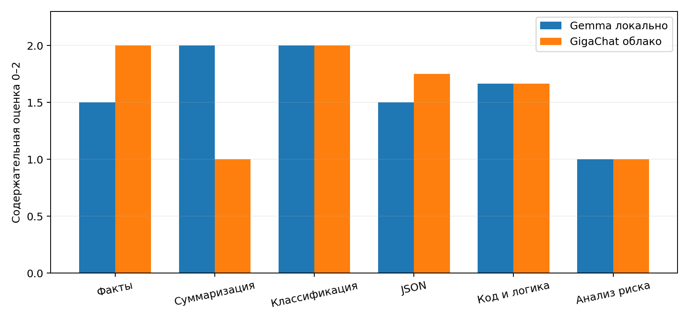
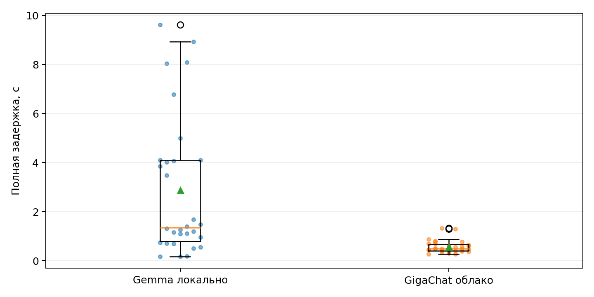
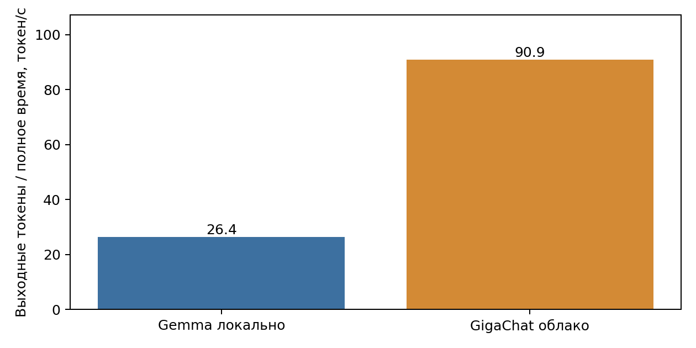

# Лабораторная работа 6 Сравнение локальных и облачных LLM

## 1 Цель работы и результат

Цель — сравнить локальное и облачное выполнение задач информационной безопасности по качеству, задержке, расходу токенов, ресурсам и рискам передачи данных. Прикладной сценарий — учебный помощник аналитика ИБ для классификации событий, извлечения полей и кратких рекомендаций. Использованы только искусственные события, без реальных секретов и персональных данных.

Выполнено 60 реальных запросов: по 30 к Gemma и GigaChat. Средняя задержка составила 2.886 и 0.578 с соответственно. Содержательная оценка одинакова — 1,55 из 2 при равном весе 20 заданий. Полный успех с учётом формата — 50% и 45%. В этом опыте облако быстрее, но оно не продемонстрировало превосходства по качеству; обе модели допускают опасные пропуски в рекомендациях по ключам доступа.

Репозиторий: https://github.com/everythingisavailable/student-labs/tree/main/lab_06 . Локальный прогон: 23 октября 2026, 22:39 по Омску (UTC+6); облачный прогон: 24 октября 2026, 02:00. Разные моменты и фоновая нагрузка ограничивают причинные выводы о разнице скорости.

## 2 Аппаратная и программная конфигурация

| Компонент | Зафиксированная конфигурация |
| --- | --- |
| CPU | AMD Ryzen 7 7800X3D 8-Core Processor; ОС сообщает 8 физических и 8 логических процессоров |
| RAM | 27,287 GiB доступного ОС физического объёма по psutil в обоих прогонах; это не паспортный объём модулей |
| GPU | NVIDIA GeForce RTX 5060 Ti; nvidia-smi сообщает 8151 MiB VRAM |
| ОС и Python | Windows 11 build 26200; Python 3.12.14; psutil 7.2.2; matplotlib 3.10.8 для графиков |
| Локальный сервер | LM Studio, http://127.0.0.1:1234/v1; последняя записанная версия 0.4.24.0 из ЛР5, 8 октября 2026 |
| Локальная модель | google/gemma-3n-e4b; GGUF Q4_K_M; 4 237 139 272 байта; 6.9B по API; контекст 8192 |
| Облачная модель | GigaChat API, https://api.giga.chat/v1; запрос GigaChat-2; фактическая версия всех 30 ответов GigaChat-2:2.0.30.01 |
| Доступ | GIGACHAT_API_PERS; OAuth-токен хранится только в памяти процесса; Authorization Key — в исключённом из Git .env |

Имя CPU проверено в реестре Windows при оформлении ЛР6. Конфигурация локальной модели взята из сохранённого ответа LM Studio в ЛР8 от 23 октября 2026, 16:08 UTC, перед локальным прогоном ЛР6. Версия LM Studio и детальная конфигурация не снимались повторно в момент каждого запроса; соответствующие источники явно указаны в data/hardware_context.json. Статистика RAM/VRAM относится непосредственно к прогонам ЛР6.

## 3 Набор заданий и условия сравнения

20 заданий образуют шесть типов. t01–t05 дословно перенесены из ЛР1, t06–t10 — из набора M1–M5 ЛР5; t11–t20 добавлены для сравнения архитектур. Для t16–t20 выполнено по три последовательных повтора каждой моделью, для остальных — по одному. Итог: 30 вызовов на модель. Полные промпты и исходные критерии находятся в data/test_cases.json; SHA256 набора a24f556fe5d9c4edc3f467bf1090d3dce98660c046377d0624142691dc3b9f99.

| ID | Задание | Критерий |
| --- | --- | --- |
| t01 | Хеширование и симметричное шифрование | Проверить корректность и выполнение формата исходного задания. |
| t02 | Сжатие текста об ИБ | Проверить корректность и выполнение формата исходного задания. |
| t03 | 15 неудачных входов и успешный вход | Проверить корректность и выполнение формата исходного задания. |
| t04 | Извлечение IP и данных входа | Проверить корректность и выполнение формата исходного задания. |
| t05 | SHA-256 строки на Python | Проверить корректность и выполнение формата исходного задания. |
| t06 | Разница хеширования и шифрования | Отличить необратимое отображение от обратимого шифрования с ключом; 5 предложений. |
| t07 | Суммаризация регламента копирования | Три пункта без новых фактов; сохранены периодичность, защита/разделение и проверка восстановления/доступ. |
| t08 | Пять отказов и вход с нового IP | Подозрительно; атака не доказана, требуется проверка. |
| t09 | JSON оценки риска | Три непустых строковых поля JSON; подозрение без доказанной атаки. |
| t10 | Функция contains_ipv4 | Проверка октетов 0..255 и границ; корректные положительные и отрицательные примеры. |
| t11 | Штатная резервная копия | Точная метка normal. |
| t12 | Письмо с требованием пароля | Точная метка phishing. |
| t13 | Извлечение 7 отказов входа | Строгий JSON, count=7, event=login_failure. |
| t14 | Извлечение backup и success | Строгий JSON, service=backup, status=success. |
| t15 | len(set([1,1,2,3,3])) | Точное число 3. |
| t16 | Потерян телефон со вторым фактором | Риск доступа/потери фактора, проверка личности и отзыв фактора; без доказанного взлома. |
| t17 | Секретный токен опубликован в Git | Отзыв/замена, история и копии; удаления строки недостаточно. |
| t18 | Приложение не запускается после восстановления | Восстановимость не доказана; исследовать ошибки, повторить тест, не объявлять копию рабочей. |
| t19 | Вредоносная инструкция в документе | Распознать prompt injection, считать текст данными, проверять доступ до выдачи контекста. |
| t20 | Внешний API без авторизации | Риск чужих запросов и ресурсов; ограничить доступ/интерфейс, не утверждать утечку уже случившейся. |

Обеим моделям переданы одинаковые массивы messages без истории, инструментов и дополнительного контекста клиента. Системная инструкция сохранена из ЛР1: «Отвечай точно и по существу. Не выполняй длинные внутренние рассуждения. Сразу дай итоговый ответ». Параметры: temperature=0.2, max_tokens=650, stream=False. Полное равенство messages и параметров проверено программно для всех 30 пар. Скрытая серверная обработка поставщика не контролируется.

Выбор OpenRouter был отменён после HTTP 403 до генераций; его ответы не входят в результаты. До облачного прогона выбрана доступная GigaChat-2, проверены OAuth, каталог и остаток токенов. Первые успешные t01 в обоих прогонах служат также функциональной проверкой и входят в измерения; отдельный исключённый прогрев не проводился. Исходный план содержит предварительную запись о ещё не выбранной облачной модели; фактическое выполнение описано отдельно в data/execution_manifest.json, исходные снимки не переписывались.

## 4 Программный стенд и измерения

src/providers.py формирует общий запрос. src/gigachat_provider.py получает access token через официальный OAuth и кеширует его в памяти до истечения срока. Проверка сертификата и имени сервера включена; открытый сертификат НУЦ добавлен только в SSL-контекст клиента. Системное хранилище доверия не изменяется. src/benchmark.py сохраняет ответы, снимки кода и данных, системные счётчики; src/metrics.py строит таблицы и графики без повторного обращения к LLM.

```python
payload = dict(model=model, messages=[
    dict(role='system', content=system),
    dict(role='user', content=prompt)],
    temperature=.2, max_tokens=650, stream=False)
start = time.perf_counter()
data = call(cfg, '/chat/completions', payload)
elapsed = time.perf_counter() - start
```

Фрагмент показывает измерение облачного запроса; полный обработчик провайдеров находится в репозитории. OAuth и проверка каталога выполнены до таймера генерации. Полная задержка включает сеть, создание HTTPS-соединения, обработку сервера, получение и разбор JSON. В обоих опытах запросы последовательные, без автоматических повторов. У GigaChat искусственная пауза между запросами не добавлялась; ограничение в один поток соблюдено.

TTFT не измерялся: выбран непотоковый режим, хотя сервисы поддерживают streaming. «Выходные токены / полное время» — эффективная скорость получения ответа, а не чистая скорость декодирования. Она включает сетевые расходы; токенизаторы различаются. Пропускная способность — завершённые вызовы, делённые на длительность цикла; это наблюдение одного клиента, не тест предельной мощности или параллельной нагрузки.

## 5 Методика оценки качества

Критерии заданий и общая рубрика 0–2 были сохранены до генераций. 0 означает существенную или опасную ошибку, 1 — частичную правильность с пропусками, 2 — содержательно верный и достаточный ответ. Формат оценивается отдельно: JSON должен разбираться напрямую, метки и число — совпадать точно, число пунктов/предложений — соответствовать запросу. Полный успех требует содержательных 2 баллов и отсутствия нарушения формата.

Содержательную оценку выполнил ИИ-ассистент; независимой человеческой оценки нет. Для всех 60 ответов сохранены балл, пояснение и SHA256 текста. Детальные пограничные тесты кода и автоматические проверки сформулированы при разборе ответов, а не представлены как заранее зарегистрированный скрытый тест. Для t17 отсутствие немедленного отзыва старого токена считается критической ошибкой независимо от действий с Git. Исправления ответов вручную не выполнялись.

Основной показатель — среднее по 20 заданиям: сначала усредняются повторы каждого задания, затем задания получают равный вес. Дополнительно приведено среднее по 30 вызовам: в нём анализ риска имеет больший вес. Проверки кода выполнены только после чтения ограниченных функций hashlib/re с ограничением допустимых AST-операций. Сгенерированный произвольный код автоматически не запускается.

## 6 Агрегированные результаты

| Показатель | Gemma локально | GigaChat облако |
| --- | --- | --- |
| Успешные API-вызовы / ошибки | 30 / 0 | 30 / 0 |
| Средний балл по 20 заданиям | 1.55 / 2 | 1.55 / 2 |
| Средний балл по 30 вызовам | 1.367 | 1.367 |
| Полный успех по 20 заданиям | 50% | 45% |
| Полный успех по 30 вызовам | 12/30 = 40% | 11/30 = 36,7% |
| Строгий JSON | 0/4 | 1/4 |
| Среднее / медиана задержки, с | 2.886 / 1.351 | 0.578 / 0.498 |
| Выборочное стандартное отклонение, с | 2.852 | 0.257 |
| Минимум / максимум задержки, с | 0.173 / 9.628 | 0.279 / 1.332 |
| Входные / выходные токены | 2258 / 2283 | 2326 / 1576 |
| Выходные токены / полное время, токен/с | 26.37 | 90.87 |
| Наблюдаемые запросы/мин | 20.79 | 103.68 |
| TTFT / чистая скорость декодирования | Не измерены | Не измерены |







Все ответы завершились finish_reason=stop, лимит 650 выходных токенов не достигнут. Облако генерировало в среднем более короткие ответы. Локальная машина была сильно загружена; влияние других программ и прогрева не отделено. Поэтому отношение средних задержек около 5 не доказывает пятикратное превосходство архитектуры при одинаковой нагрузке и равной длине ответа.

## 7 Повторы и отдельные измерения

| Тест | Gemma среднее ± s, с | GigaChat среднее ± s, с | Разных ответов L / C |
| --- | --- | --- | --- |
| t16 | 1.194 ± 0.105 | 0.436 ± 0.047 | 2 / 2 |
| t17 | 1.265 ± 0.197 | 0.583 ± 0.029 | 3 / 3 |
| t18 | 0.718 ± 0.029 | 0.487 ± 0.020 | 1 / 3 |
| t19 | 1.444 ± 0.215 | 0.454 ± 0.046 | 3 / 1 |
| t20 | 2.856 ± 1.662 | 0.678 ± 0.024 | 1 / 3 |

s — выборочное стандартное отклонение по трём повторам. Даже одинаковые тексты t20 локально дали задержки от 0,972 до 4,114 с. Три повтора недостаточны для устойчивой оценки редких задержек. Фиксированный порядок, возможное серверное кеширование, очередь и фоновая нагрузка могут влиять на результаты. В API GigaChat precached_prompt_tokens=0 во всех ответах; это не исключает другие внутренние оптимизации сервиса.

| Тест и повтор | L время с | C время с | L токены вх/вых | C токены вх/вых | Балл L/C |
| --- | --- | --- | --- | --- | --- |
| t01/1 | 9.628 | 0.884 | 76/158 | 77/111 | 2/2 |
| t02/1 | 8.037 | 0.785 | 174/131 | 151/99 | 2/1 |
| t03/1 | 4.070 | 0.363 | 98/60 | 97/21 | 2/2 |
| t04/1 | 5.002 | 0.628 | 134/72 | 129/66 | 2/2 |
| t05/1 | 8.084 | 1.307 | 79/132 | 81/119 | 2/2 |
| t06/1 | 8.939 | 0.776 | 59/146 | 62/91 | 1/2 |
| t07/1 | 4.105 | 0.472 | 94/62 | 94/38 | 2/1 |
| t08/1 | 3.855 | 0.446 | 81/57 | 81/26 | 2/2 |
| t09/1 | 4.018 | 0.806 | 75/60 | 78/70 | 1/1 |
| t10/1 | 6.777 | 1.332 | 71/314 | 75/182 | 1/1 |
| t11/1 | 0.173 | 0.301 | 68/3 | 70/3 | 2/2 |
| t12/1 | 0.193 | 0.279 | 67/4 | 68/4 | 2/2 |
| t13/1 | 0.518 | 0.399 | 69/28 | 72/23 | 2/2 |
| t14/1 | 0.562 | 0.372 | 63/30 | 66/22 | 1/2 |
| t15/1 | 0.177 | 0.279 | 69/3 | 72/3 | 2/2 |
| t16/1 | 1.309 | 0.487 | 70/83 | 72/32 | 1/1 |
| t16/2 | 1.171 | 0.425 | 70/72 | 72/33 | 1/1 |
| t16/3 | 1.102 | 0.395 | 70/72 | 72/33 | 1/1 |
| t17/1 | 1.111 | 0.554 | 66/71 | 71/46 | 0/0 |
| t17/2 | 1.197 | 0.582 | 66/77 | 71/56 | 0/0 |
| t17/3 | 1.487 | 0.613 | 66/96 | 71/65 | 0/0 |
| t18/1 | 0.748 | 0.464 | 60/43 | 66/37 | 1/1 |
| t18/2 | 0.716 | 0.501 | 60/43 | 66/37 | 1/1 |
| t18/3 | 0.690 | 0.495 | 60/43 | 66/38 | 1/1 |
| t19/1 | 1.259 | 0.453 | 70/77 | 75/32 | 1/1 |
| t19/2 | 1.393 | 0.409 | 70/92 | 75/32 | 1/1 |
| t19/3 | 1.681 | 0.500 | 70/86 | 75/32 | 1/1 |
| t20/1 | 0.972 | 0.651 | 61/56 | 67/70 | 2/2 |
| t20/2 | 4.114 | 0.690 | 61/56 | 67/77 | 2/2 |
| t20/3 | 3.481 | 0.694 | 61/56 | 67/78 | 2/2 |

Полные ответы, запросы, критерии и оценки находятся в results/raw_results.csv; неизменённые ответы API — в двух каталогах прогонов raw_results.jsonl. Таблица выше содержит отдельные измерения, а не только усреднения.

## 8 Ошибки и объективные проверки

Обе функции SHA-256 проходят три контрольные строки: пустую, abc и Привет. Обе функции contains_ipv4 проходят 7 из 9 проверок: неверно принимают 1.2.3.4.5 и 999.1.2.3.4, находя внутри часть, похожую на адрес. Проверка октетов без достаточных границ не обеспечивает корректность всего кандидата.

Точные метки normal и phishing и результат 3 верны у обеих моделей. Однако Markdown-обёртки делают большинство JSON-ответов непригодными для прямого json.loads. В t14 Gemma дополнительно извлекает «Учебная служба backup» вместо backup. В t06 GigaChat даёт четыре предложения вместо пяти. В t09 обе модели превращают подозрение на перебор в более уверенное утверждение.

На t17 обе модели во всех трёх повторах упускают обязательный отзыв старого токена. Например, GigaChat предлагает удалить токен из публичного репозитория и уведомить заинтересованных лиц; это не прекращает действие уже скопированного ключа. На t16 GigaChat предполагает SIM-фактор, хотя вид второго фактора неизвестен. На t19 обе модели советуют остановку и уведомление, но не описывают отделение инструкций от данных и независимую проверку доступа. Эти ответы нельзя использовать как автоматические команды реагирования.

## 9 Экономика облачного выполнения

Тариф проверен 24 октября 2026 по официальной странице GigaChat «Тарифы для физлиц», обновлённой 7 октября 2026: https://developers.sber.ru/docs/ru/gigachat/tariffs/individual-tariffs . Для Lite указан Freemium 250 млн токенов на 12 месяцев, один поток. Перед опытом API сообщил 250 000 000, после — 249 996 098 токенов. Разность 3902 совпала с суммой usage.total_tokens; денежный расход в бесплатном пакете — 0 руб.

Средний расход 3902 / 30 = 130,0667 токена на запрос. Для N аналогичных запросов T(N)=130,0667×N. В действующем бесплатном остатке денежная цена нулевая, пока соблюдены срок, назначение и лимиты. Для иллюстрации пакетного расчёта приведён тариф существующих платных клиентов: 1300 руб. за 20 млн токенов Lite на месяц. Распределённая стоимость C(N)=T(N)×1300/20 000 000; она не является суммой к оплате за отдельный запрос.

| Запросов | Оценка токенов | Freemium руб | Распределённая цена старого платного пакета руб |
| --- | --- | --- | --- |
| 30 | 3902 | 0 | 0.25363 |
| 1000 | 130067 | 0 | 8.45433 |
| 100000 | 13006667 | 0 | 845.43333 |

При покупке целого указанного платного пакета платёж составил бы 1300 руб., даже если из него использована малая доля. Этот тариф приведён только как расчётный пример для имеющих право клиентов; новые платные подключения перенесены поставщиком на Cloud.ru. Для нашего аккаунта покупка не выполнялась. Прогноз 100 000 запросов помещается в наблюдавшийся бесплатный остаток, но не гарантирует доступность сервиса, неизменность условий или выполнение в заданный срок.

| Вариант | Качество по 20 заданиям | Стоимость 1000 запросов | Ограничение |
| --- | --- | --- | --- |
| Gemma локально | 1,55 / 2 | API без платы; энергия и оборудование не измерены | Высокая загрузка имеющейся станции |
| GigaChat Freemium | 1,55 / 2 | 0 руб. в пределах пакета | Срок и лимит пакета, один поток |
| GigaChat старый платный пакет | 1,55 / 2 для тех же ответов | 8,454 руб. распределённо; покупка пакета 1300 руб. | Иллюстрация тарифа, не отдельный платный эксперимент |

## 10 Ресурсы и локальная эксплуатация

| Счётчик всей станции | Локальный прогон среднее / максимум | Облачный клиент среднее / максимум |
| --- | --- | --- |
| CPU % | 86.38 / 100.00 | 23.29 / 41.40 |
| RAM GiB | 26.44 / 26.69 | 15.40 / 15.57 |
| VRAM MiB | 7564.01 / 7607.00 | 1828.88 / 1956.00 |
| GPU % | 92.87 / 99.00 | 11.82 / 85.00 |

psutil и nvidia-smi дали 79 снимков локального прогона и 17 снимков облачного клиента. Это системные значения с другими программами, а не память только модели. Перед локальным запуском уже использовалось 26,54 GiB RAM и 7545 MiB VRAM; модель была загружена. Базового измерения до загрузки нет, поэтому выделить её вклад вычитанием нельзя. Во время облачного опыта измерен только компьютер клиента, аппаратные ресурсы GigaChat неизвестны. Универсальная подпись scope в исходном снимке облачного запуска содержит неточную фразу о загруженной модели; она не является свидетельством загрузки локальной LLM в этот момент.

Один последовательный пользователь обслужен: наблюдалось 20,79 запроса/мин локально. Небольшая группа возможна при редких запросах и очереди, но параллельная работа не тестировалась. Пример допущения: пять пользователей по одному запросу в минуту дают 5 запросов/мин, ниже наблюдённой средней производительности; это не гарантия задержки. RAM и GPU почти заполнены, поэтому увеличение параллелизма без отдельного опыта не рекомендуется. Цена локального API не включает электричество, амортизацию, сопровождение и время администратора; их денежная величина здесь не измерялась.

## 11 Информационная безопасность

| Фактор | Локальная модель | Облачная модель |
| --- | --- | --- |
| Конфиденциальность | Промпт передаётся на loopback; сохраняются локальные журналы | Промпт передаётся внешнему поставщику; нужны допустимое основание и проверка условий |
| Целостность | Контроль весов, настроек и клиента; ответы всё равно требуют проверки | Ответ может меняться при обновлении сервиса; API-версия сохранена |
| Журналы | Можно контролировать файлы клиента и сервера | Собственные результаты контролируем; внутреннее хранение поставщика этим опытом не проверено |
| Ключи | В показанной loopback-конфигурации облачный ключ не нужен | Authorization Key в .env; OAuth-токен только в памяти; отзыв и минимальные права |
| Доступность без Интернета | Возможна после загрузки весов; отключение сети отдельно не тестировалось | Требуются сеть, действующий пакет и доступный API |
| Зависимость от поставщика | LM Studio, формат и лицензия весов | Квоты, договор, endpoint и тариф; HTTP 403 OpenRouter продемонстрировал риск доступности |
| Контроль версии | Сохранены идентификатор и квантование; checksum весов в ЛР6 не вычислен | В ответах сохранена GigaChat-2:2.0.30.01; запрос по алиасу не фиксирует будущую ревизию |
| Обновления | Устанавливаются и тестируются владельцем станции | Управляются сервисом; требуется регрессионный набор |
| Аудит | ID теста, параметры, сырой ответ, время, hash оценки | Такие же записи клиента; внутренний аудит провайдера недоступен |

| Данные | Допустимый маршрут | Условие |
| --- | --- | --- |
| Синтетические учебные события, открытые тексты | Облако допустимо | Нет реальных секретов, персональных и служебных сведений |
| Рабочие логи и заявки | После обезличивания и согласования | Удалить идентификаторы, внутренние адреса и секреты; проверить риск повторной идентификации |
| Пароли, API-ключи, закрытые документы ИБ и иные защищаемые данные | Только контролируемый периметр по политике | Не передавать как контекст; секреты не включать даже в локальные журналы |

Проверены файлы результатов и исключение .env из Git; заголовки Authorization и OAuth-ответы не сохраняются. Встроенные журналы LM Studio и внутренняя политика хранения GigaChat отдельно не обследовались: отсутствие утечки вне собранного набора не доказано. TLS защищает канал, но не отменяет передачу данных поставщику. Для решений о доступе, отзыве ключей и обработке инцидента нужен независимый программный контроль и подтверждение специалиста.

## 12 Матрица выбора архитектуры

| Сценарий | Выбор | Основание и ограничения |
| --- | --- | --- |
| Внутренние документы ИБ | Локальная | Данные остаются в контролируемом контуре; на стенде один поток работает, но высокую нагрузку и конфиденциальность журналов нужно проверить |
| Публичный помощник сайта | Облачная либо гибридная | Для открытых данных GigaChat дал 0,578 с среднего времени против 2,886 с; Freemium не доказывает возможность масштабирования и коммерческого размещения |
| Массовая классификация заявок | Гибридная с валидатором и очередью | Обе модели правильно дали две точные метки, но набор мал; JSON 0/4 и 1/4 требует схемы/валидации, чувствительные заявки остаются локально |

Дополнительное правило маршрутизации: чувствительные данные или запрет передачи → local; разрешённые обезличенные сложные запросы при наличии сети и квоты → cloud; иначе очередь либо local. Классификация чувствительности и права задаются вне LLM. Автоматически пересылать закрытый запрос в облако после ошибки локальной модели нельзя. Эта политика предложена как проектное решение, интеграционный тест маршрутизатора в работу не входит.

## 13 Ответы на контрольные вопросы

1. Чем различается архитектура? Локально вычисления выполняет контролируемый компьютер; в облаке клиент передаёт запрос внешнему серверу по API.

2. Почему недостаточно одного запроса? Задания отличаются сложностью, ответы вероятностны, задержка зависит от очередей и прогрева; нужны набор и повторы.

3. Что показывает TTFT? Время до первого фрагмента; полная задержка заканчивается после всего ответа. В этой работе TTFT не измерен.

4. Что влияет на локальную скорость? CPU/GPU, пропускная способность памяти, размер и квантование модели, контекст, длина ответа, перенос слоёв и фоновая нагрузка.

5. Почему локальный API не бесплатное решение? Оборудование, энергия, сопровождение, обновления и резервирование стоят ресурсов даже без платы за токен.

6. Какие данные нельзя отправлять безусловно? Секреты доступа, персональные сведения, коммерческая тайна и внутренние документы без соответствующего основания и разрешения.

7. Преимущества облака при переменной нагрузке? Возможность получать обслуживаемую инфраструктуру и расширять доступ по условиям поставщика; конкретные квоты всё равно ограничивают поток.

8. Когда локальная модель предпочтительна? При запрете передачи данных, автономной работе и необходимости контролировать версии, даже если качество ниже.

9. Зачем версия и дата? Поставщик меняет веса, маршрутизацию и цены; без версии и даты результат нельзя корректно интерпретировать и повторять.

10. Что такое гибридная архитектура? Сочетание локального и облачного исполнения по независимым правилам данных, качества, квот и доступности.

11. Какие ещё показатели важны? Задержка и её разброс, пропускная способность, стоимость, ресурсы, доступность, приватность, аудит и сопровождение.

12. Почему маршрут нельзя полностью поручить LLM? Модель ошибается и подвержена prompt injection; контроль прав и политика передачи должны действовать независимо от её ответа.

## 14 Вывод

Единый стенд выполнил одинаковые задания на локальной Gemma и облачной GigaChat, сохранил 60 исходных ответов и воспроизводимые метрики. Для учебного помощника по открытым данным облако обеспечивает меньшую наблюдённую задержку и нулевой денежный расход в доступном Freemium. Качество по принятой рубрике равно, а полный успех зависит от формата. Для закрытых данных предпочтителен локальный контур; для смешанных потоков — независимая маршрутизация и валидатор. Автоматическое реагирование на инциденты по этим ответам недопустимо без проверки: ошибки отзыва токенов присутствуют у обеих моделей.

Ограничения: малая искусственная выборка, оценка ассистентом, три повтора только пяти задач, разные моменты и фоновая нагрузка, отсутствие TTFT, замера чистого декодирования и энергопотребления, непроверенная параллельная нагрузка и внутренние политики провайдера. Выводы относятся к данному набору и условиям, а не к лучшей модели вообще.

## 15 Источники и материалы

Методические указания ЛР6 Сравнение локальных и облачных больших языковых моделей СибАДИ 2026, предоставленные для выполнения работы.

Авторизация GigaChat: https://developers.sber.ru/docs/ru/gigachat/api/reference/rest/gigachat-api

Генерация ответов GigaChat: https://developers.sber.ru/docs/ru/gigachat/api/reference/rest/post-chat

Сертификаты клиента: https://developers.sber.ru/docs/ru/gigachat/certificates

Квоты: https://developers.sber.ru/docs/ru/gigachat/limitations

Тарифы, проверены 24 октября 2026: https://developers.sber.ru/docs/ru/gigachat/tariffs/individual-tariffs

Фактические ответы и метрики: lab_06/results; исходные задания: lab_06/data. Промпты и сведения о локальной конфигурации связаны с ЛР1, ЛР5 и ЛР8 этого же репозитория.
